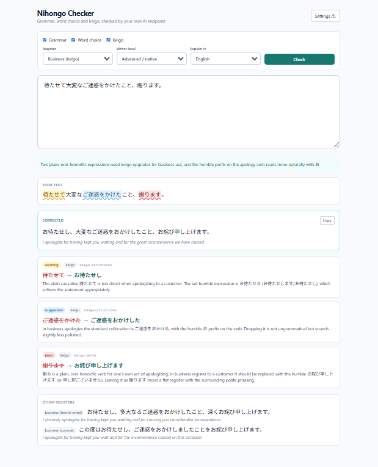

# Nihongo Checker

AI-powered Japanese grammar, word choice and keigo checker. Paste a Japanese text, get corrections with explanations, a translation, and rewrites in other registers. It runs on **your own** OpenAI-compatible endpoint (for example a local agent behind [9router](https://github.com/decolua/9router)), so you only need to enter an API endpoint and a model name.

Built with Next.js (App Router), TypeScript and Tailwind CSS v4.

## Features

- **Three check types**: grammar (particles, conjugation, transitivity, style consistency), word choice (collocations, literal translations, kanji confusion) and keigo (honorific/humble forms, double keigo, uchi/soto usage).
- **Inline highlights**: each problem is marked in your original text, color-coded by severity (error, warning, suggestion).
- **Explained fixes**: every issue shows the original, the suggestion, the category and a short reason.
- **Corrected text** with a copy button and a **translation** of it.
- **Other registers**: rewrites in casual, polite or business style, each with a translation.
- **Register and level control**: auto-detect, casual, polite, business, formal; writer level from JLPT N5 to N1 or native.
- **Explanation language**: Bahasa Indonesia, English or Japanese.
- **Built-in knowledge base**: curated grammar, vocabulary and keigo notes are injected into the prompt only when relevant to your text, which keeps prompts small and answers more accurate.
- **Provider-agnostic**: works with any endpoint that supports `/chat/completions`.



## Requirements

- Node.js 18.18 or newer
- npm
- An OpenAI-compatible chat completions endpoint and a model name (a model with good Japanese ability is recommended)

## Installation

```bash
git clone https://github.com/fiqryx/nihongo-checker.git
cd nihongo-checker
npm install
```

## Configuration

You can configure the AI endpoint in either of two ways.

**1. In the UI (simplest).** Start the app, click **Settings** and fill in:

| Field | Example |
| --- | --- |
| API endpoint | `http://localhost:20128/v1` |
| Model name | `your-model-name` |
| API key (optional) | `sk-...` |

Values are stored in your browser's local storage. `/chat/completions` is appended to the endpoint automatically.

**2. With environment variables.** Copy the example file and edit it:

```bash
cp .env.example .env.local
```

```env
LLM_BASE_URL=http://localhost:20128/v1
LLM_MODEL=your-model-name
LLM_API_KEY=
```

Values set in the UI take priority over environment variables. Leave `LLM_API_KEY` empty if your endpoint does not need a key.

## Usage

Development:

```bash
npm run dev
```

Production:

```bash
npm run build
npm run start
```

Then open <http://localhost:3000>.

1. Make sure the endpoint and model are set (the Settings button shows ✓ when they are).
2. Choose what to check: **Grammar**, **Word choice**, **Keigo**.
3. Pick the **Register**, **Writer level** and the language to **Explain in**.
4. Type or paste Japanese text (up to 3,000 characters) and click **Check** or press `Ctrl/Cmd + Enter`.
5. Review the highlighted text, the corrected version, the issue cards and the alternative registers.

## How it works

```
Browser (page.tsx)
   │  POST /api/check  { text, modes, register, level, explainLang, llm }
   ▼
API route (route.ts)
   ├─ validates input
   ├─ builds the prompt (prompt.ts) + selects relevant knowledge (knowledge/*)
   ├─ calls  {endpoint}/chat/completions
   └─ strips <think> blocks / code fences, parses and validates the JSON
   ▼
Result: corrected text, translation, issues[], alternatives[]
```

### Project structure

```
src/
├─ app/
│  ├─ page.tsx            # UI: settings, options, results
│  ├─ layout.tsx
│  ├─ globals.css
│  └─ api/check/route.ts  # calls the LLM endpoint, validates the response
└─ lib/
   ├─ prompt.ts           # system prompt and output schema
   ├─ types.ts
   └─ knowledge/
      ├─ index.ts         # knowledge selection (always + regex triggers)
      ├─ grammar.ts
      ├─ vocab.ts
      └─ keigo.ts
```

## Knowledge base

Knowledge lives in `src/lib/knowledge/`. Each entry is either always included for the active check types (`always: true`) or included only when one of its regex `triggers` matches the input text.

Add your own entry:

```ts
{
  id: "my-rule",
  modes: ["grammar"],            // grammar | vocabulary | keigo
  title: "Short title",
  triggers: ["regex1", "regex2"], // omit and set always: true to always include
  body: "Rule text with ×wrong → 〇correct examples.",
}
```

The model also uses its own knowledge; the notes guide it and are not an exhaustive rule set. If keyword triggers become too limiting, replace `selectKnowledge()` in `knowledge/index.ts` with embeddings or SQLite FTS. Callers do not need to change.

Useful sources for expanding it (check each license before bundling text):

- 文化庁「敬語の指針」 for keigo classification and examples
- JMdict / KANJIDIC2 (EDRDG, CC BY-SA) for vocabulary and kanji
- Tatoeba (CC BY 2.0 FR) for example sentences
- NINJAL corpora (BCCWJ, learner corpora) for real usage; access terms vary

## Troubleshooting

| Message | Cause and fix |
| --- | --- |
| Please set the API endpoint and model name in Settings first. | Neither the UI nor `.env.local` has values. Fill them in. |
| Could not reach the AI endpoint. | The endpoint URL is wrong or the server is not running. |
| The AI endpoint returned an error (4xx/5xx). | Check the model name, API key and endpoint logs. |
| The AI reply was not valid JSON. | The model ignored the output format. Try a stronger model or lower its temperature on the router side. |
| Explanations come back in Japanese. | A small model ignored the language rule. Use a stronger model. |

## Notes

- The endpoint URL is sent from the browser to the server route and the server then makes the request. Run the app locally or behind your own authentication, and do not expose it publicly with API keys configured.
- Results are AI-generated and may contain mistakes. Treat them as suggestions, especially for severity "suggestion" items.

## License

Add your license here (for example MIT).